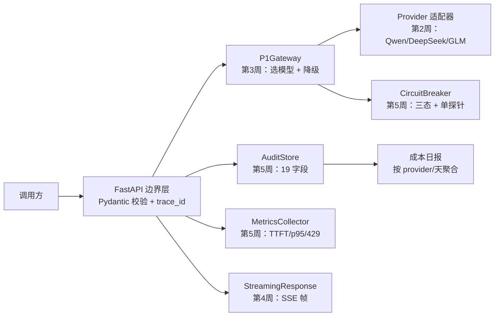

# P1 · 多模型统一网关服务

> 第一阶段收尾项目：第 3 周网关骨架 → 第 4 周缓存/流式/并发 → 第 5 周稳定性 → 第 6 周 HTTP 交付。
> 配套练习：[`week06/README.md`](../README.md) · 阶段复盘：[`STAGE_REVIEW.md`](../STAGE_REVIEW.md)

## 架构图（数据流，不是目录树）



**边界原则**：FastAPI 只管 HTTP 形状；网关、适配器、熔断、审计、指标全部复用前几周实现，本项目不重写。

## 接口列表

| 方法 | 路径 | 作用 | 关键返回 |
| --- | --- | --- | --- |
| POST | `/v1/chat` | 统一聊天入口 | `answer / provider / latency_ms / cost_yuan / trace_id` |
| GET | `/v1/chat/stream?question=...` | SSE 流式出口 | `text/event-stream`，末帧 `[DONE]` |
| GET | `/healthz` | liveness，进程是否存活 | `{"status":"ok"}` |
| GET | `/readyz` | readiness，任一熔断打开返 503 | `breaker_states` |
| GET | `/metrics` | 指标快照 | 成功率 / p95 / 429 比例 / 命中率 |
| GET | `/docs` | 自动 OpenAPI 文档 | Swagger UI |

非法请求（空 question）返回 422；全部模型不可用由网关抛错，上层再决定降级文案。

## 快速开始

```bash
# 本地（无需 API Key，默认 Mock）
uv sync
uv run python -m week06.p1_fastapi
# 另一个终端
curl -X POST http://127.0.0.1:8000/v1/chat \
  -H 'Content-Type: application/json' \
  -d '{"question":"系统 cyclone 级别 2 影响 30 人"}'

# 容器（真 Key 从环境变量注入，不写进镜像）
docker compose -f week06/p1_fastapi/docker-compose.yml up --build
```

无端口测试（CI 推荐）：

```bash
uv run python -m week06.engineering.engineering_demo
uv run pytest --cov=week06 --cov-report=term-missing --cov-fail-under=60
```

## 关键设计决策

| 决策 | 为什么这么选 | 放弃了什么 / 代价 |
| --- | --- | --- |
| HTTP 模型与内部模型分离 | 内部重构不破坏外部契约，OpenAPI 自动可用 | 多一层字段映射 |
| `Depends(get_container)` 单例容器 | 审计库/指标跨请求共享；测试可 override | 全局状态需 `reset_container()` 清理 |
| readiness 读熔断状态 | 模型故障时摘流量，而不是重启容器 | 需要各 provider 的 breaker 都注册进容器 |
| 流式用 SSE 而非 WebSocket | 单向推送足够，浏览器 EventSource 原生支持 | 不支持客户端反向实时消息 |
| 单价从配置读、不写死 | 厂商调价只改配置；成本记在实际 provider 上 | 需维护配置表，示意值不能当真实账单 |
| 生产镜像 `--no-dev` + 非 root | 减小攻击面与镜像体积 | 调试工具不在镜像内，需靠日志/指标排障 |

## 与"只会调 API"的区别

1. 有统一 Provider 抽象，三家模型可配置切换与自动降级；
2. 有 access_token 缓存安全边界、令牌桶与并发压测数据；
3. 有三态熔断、分层超时、可重试错误判据与幂等键；
4. 每次调用都有 19 字段审计、trace 串联和按 provider 的成本日报；
5. 有 HTTP 契约、健康检查、容器化、单测门禁与可复现部署。

叙事载体见 [`BLOG.md`](BLOG.md)。
